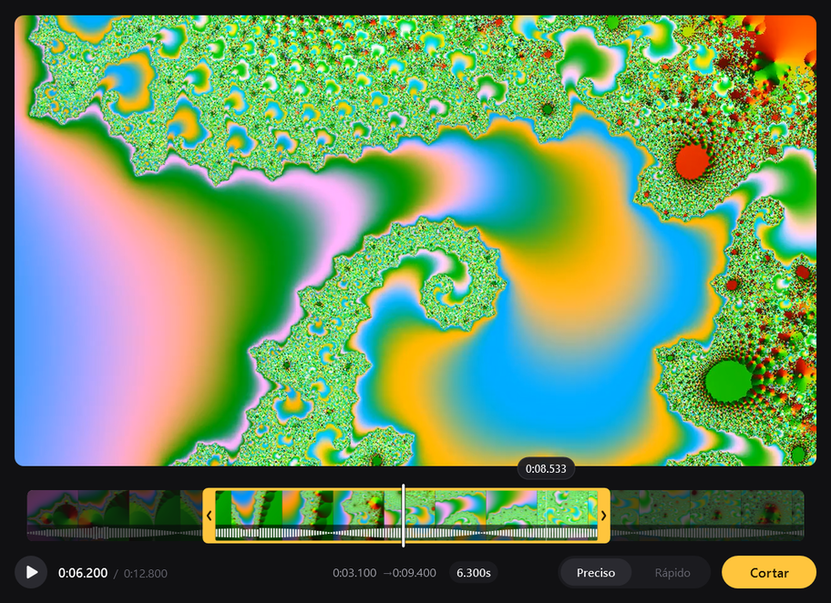
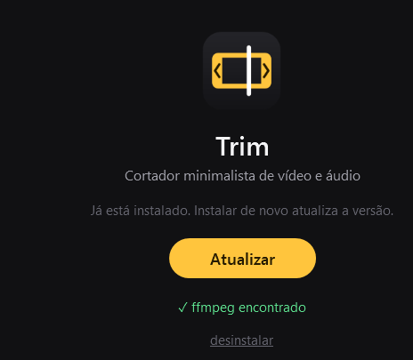

# Trim

Cortador de vídeo e áudio ultra leve para Windows, direto do clique direito do Explorer.



Clique com o botão direito num vídeo ou áudio → **Cortar com Trim** → marque o trecho → **Cortar**.
O resultado sai na mesma pasta como `nome_trim.mp4` — e `nome_trim (1).mp4`, `nome_trim (2).mp4`… se já existir.

- **Leve** — um `.exe` de ~150 KB que abre em ~0,4 s e fica em 0% de CPU parado. Usa o .NET Framework 4.8 que já vem no Windows.
- **Preciso** — corta no quadro exato: o primeiro e o último quadro do arquivo final são exatamente os que você vê na tela.
- **Rápido** — prévia decodificada na GPU; corte com x264 (ou NVENC, quando o driver suporta), ou sem recodificar no modo Rápido.

## Instalar

1. Baixe o **TrimSetup.exe** na página de [Releases](../../releases/latest).
2. Abra e clique em **Instalar**. Não precisa de administrador.
   O Windows pode avisar "O Windows protegeu o computador", porque o instalador não é assinado: clique em **Mais informações → Executar assim mesmo**.
3. O Trim usa o [ffmpeg](https://ffmpeg.org) para cortar. Se ele já estiver no PATH (ou vier com o ShareX), é usado automaticamente; se não, o instalador oferece instalar pelo `winget`.



Instalação silenciosa: `TrimSetup.exe /S`. Para desinstalar: **Configurações → Aplicativos → Trim**.

## Usar

| | |
|---|---|
| Arrastar as alças amarelas | marcar início e fim |
| **I** / **O** | marcar início / fim no ponto atual |
| **←** **→** | 1 quadro (Shift: 1 s · Ctrl: 5 s) |
| Roda do mouse | no vídeo: quadro a quadro · na timeline: zoom |
| Clicar nos tempos | digitar o início/fim exato |
| **Espaço** · **P** | play/pausa · tocar só o trecho |
| **Home** / **End** | ir ao início / fim do trecho |
| **Tab** | alternar Preciso ↔ Rápido |
| **Enter** | cortar |
| **Esc** | cancelar / fechar |
| **F1** | todos os atalhos |

### Modos de corte

| Modo | |
|---|---|
| **Preciso** (padrão) | corte no quadro exato; recodifica o vídeo e o áudio |
| **Rápido** | instantâneo e sem perda de qualidade; sem recodificar, então começa no keyframe anterior ao ponto marcado |

**Formatos** — vídeo: mp4, m4v, mov, mkv, webm, avi, wmv, asf, flv, ts, mts, m2ts, 3gp, mpg, mpeg, vob, ogv · áudio: mp3, wav, m4a, aac, flac, ogg, oga, opus, wma, aif, aiff, ac3, amr, mka.

## Como funciona

- Interface em WPF (.NET Framework 4.8, C# 5) desenhada à mão, sem XAML.
- A prévia usa o Media Foundation Media Engine do Windows em modo *frame server*: a GPU decodifica e redimensiona cada quadro direto para o tamanho exibido, então a memória não cresce com a resolução do vídeo. Arquivos só de áudio nem carregam driver de vídeo.
- O Media Foundation ignora as *edit lists* do MP4, que o ffmpeg respeita (vídeos com B-frames apareciam 2 quadros adiantados). O Trim lê o cabeçalho `moov` do arquivo e compensa, para a prévia bater com o corte.
- O corte é feito pelo ffmpeg, buscando meio quadro antes do início e com duração exata, na base de tempo original do arquivo — assim entram exatamente os quadros marcados.
- Miniaturas e forma de onda são gerados em segundo plano pelo ffmpeg.

## Compilar

Não precisa de Visual Studio nem de SDK: usa o compilador C# que já vem com o Windows.

```powershell
powershell -ExecutionPolicy Bypass -File build.ps1     # gera bin\Trim.exe e bin\TrimSetup.exe
powershell -ExecutionPolicy Bypass -File install.ps1   # instala o build local
```

| Pasta | |
|---|---|
| `src/` | o app |
| `setup/` | o instalador (embute o `Trim.exe`) |
| `assets/` | ícone e manifesto |
| `tools/MakeIcon.cs` | gera o ícone |

## Licença

[MIT](LICENSE). O ffmpeg não vem junto com o Trim; ele é um programa à parte, com a licença dele.
